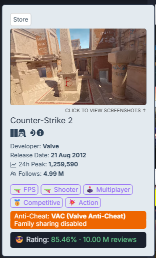

# Popup Hotkeys for SteamDB

A browser extension that adds keyboard shortcuts to the **Store**, **Wishlist**, **Follow** and **Ignore** buttons in the game popup on [steamdb.info](https://steamdb.info/).

Hover over a game, press a key, done. No more moving the mouse into the popup and overshooting it so it disappears.

It also works on game pages on the Steam store (`store.steampowered.com/app/…`), where <kbd>W</kbd>, <kbd>F</kbd> and <kbd>I</kbd> press Steam's own Wishlist, Follow and Ignore buttons. It does nothing on any other site.

[](https://github.com/razingo/hotkeys-steamdb/actions/workflows/tests.yml)

| With the [SteamDB extension](https://github.com/SteamDatabase/BrowserExtension) and a linked Steam account | Without them |
|:---:|:---:|
|  |  |
| <kbd>S</kbd> <kbd>W</kbd> <kbd>F</kbd> <kbd>I</kbd> all work | Only <kbd>S</kbd> works |

> [!NOTE]
> This is an independent, unofficial project. It is **not affiliated with, endorsed by or sponsored by Steam, Valve Corporation or SteamDB.**

## Shortcuts

| Key | Action |
|-----|--------|
| <kbd>S</kbd> | Open the game's Steam store page (in a background tab by default) |
| <kbd>W</kbd> | Add to or remove from your wishlist |
| <kbd>F</kbd> | Follow or unfollow |
| <kbd>I</kbd> | Ignore or unignore |

- On steamdb.info, shortcuts work while a game popup is open.
- On a Steam store game page, <kbd>W</kbd>, <kbd>F</kbd> and <kbd>I</kbd> work whenever Steam shows its Wishlist, Follow and Ignore buttons, which is when you're signed in to Steam. <kbd>S</kbd> does nothing there, since you're already on the store page. This can be turned off in the settings.
- Shortcuts never fire while you're typing in a search box or other text field.
- All shortcuts can be changed, including combinations such as <kbd>Ctrl</kbd> + <kbd>Shift</kbd> + <kbd>Q</kbd>, or turned off.
- Keys go by their physical position, so they work with any keyboard layout.
- Each shortcut has a 1-second cooldown. Wishlist, Follow and Ignore share it, because each one sends a request to Steam and pressing keys quickly can get you temporarily blocked. A press during the cooldown is ignored and the button flashes amber.

## Requirements

- Chrome, Edge, Brave, Opera or another Chromium-based browser, or Firefox 140 or newer.
- On Steam store game pages: being signed in to Steam.
- For Wishlist, Follow and Ignore on steamdb.info:
  - Your Steam account linked to SteamDB (**Sign in** on steamdb.info).
  - The official [SteamDB extension](https://github.com/SteamDatabase/BrowserExtension), and being signed in to the Steam store in the same browser.

  steamdb.info only shows those buttons when SteamDB's extension is installed, and it carries them out; this one only presses the buttons for you. The Store shortcut works without either.

## Install

The extension isn't in the browser stores yet, so it's loaded from source.

### Chrome, Edge, Brave, Opera

1. Download this repository (**Code → Download ZIP**) and unzip it, or clone it.
2. Open `chrome://extensions` (or `edge://extensions`).
3. Turn on **Developer mode**.
4. Click **Load unpacked** and choose the folder that contains `manifest.json`.
5. Reload any open steamdb.info tabs.

Keep the folder where it is: the browser loads the extension from it. To update, replace the files and click the reload icon on the extension's card.

### Firefox

1. Open `about:debugging#/runtime/this-firefox`.
2. Click **Load Temporary Add-on…** and choose `manifest.json`.

Firefox removes temporary add-ons when it restarts.

## Settings

Click the extension's toolbar icon, or open its **Options** from the extensions page.

- **Change a shortcut:** click it and press the new key or combination. <kbd>Esc</kbd> cancels.
- **Turn a shortcut off:** press <kbd>Backspace</kbd> while it's waiting for a key, or click **×**.
- **Store page:** choose whether it opens in a background tab or switches to it.
- **Steam store game pages:** turn the shortcuts on Steam's own pages on or off.
- **Sync settings between your browsers:** on by default, using your browser's sync when that's turned on. Turn it off to keep this browser's shortcuts to itself; the setting is per browser.
- **Reset to defaults** restores S / W / F / I and the options above, except sync.
- The **About** tab and the buttons at the bottom link to this repository and to Buy Me a Coffee.

Settings save immediately and apply to open tabs without reloading.

## Privacy

The extension collects no data and makes no network requests of its own. Your shortcut settings are stored with your browser's extension storage.

Permissions:

| Permission | Why |
|------------|-----|
| `storage` | Save your shortcut settings |
| Content script on `https://steamdb.info/*` | Listen for the shortcuts on SteamDB pages |
| Content script on `https://store.steampowered.com/app/*` | Listen for the shortcuts on Steam store game pages |

It also opens new tabs, but only for `https://store.steampowered.com/` pages.

## How it works

SteamDB draws the popup itself, so the extension finds it by its visible text (the Store button and "Click to view screenshots", or all four button labels) rather than by the site's internal class names. When a shortcut is pressed while the popup is visible, it clicks the matching button, exactly as a mouse click would. A key whose button isn't in the popup is left alone.

On Steam store game pages, it looks for buttons labelled Wishlist, Follow and Ignore in the box under the game's header, and presses whichever version is shown (e.g. "Follow" or "Following").

If SteamDB or Steam change that text, or show it in another language, the shortcuts can stop working. Please [open an issue](https://github.com/razingo/hotkeys-steamdb/issues) if that happens.

| File | Purpose |
|------|---------|
| `manifest.json` | Extension manifest (Manifest V3, Chrome and Firefox) |
| `shared.js` | Default shortcuts, settings storage and key matching, used by both scripts below |
| `content.js` | Runs on steamdb.info and Steam store game pages: finds the buttons and handles the shortcuts |
| `background.js` | Opens the store page in a new tab |
| `options.html`, `options.css`, `options.js`, `tabs.js` | Settings page and toolbar popup |
| `icons/` | Extension icons (16, 32, 48 and 128 px) |
| `docs/` | Screenshots for this README (not part of the extension) |
| `store/` | Screenshots, promo tile and [publishing guide](store/PUBLISHING.md) for the browser stores (not part of the extension) |
| `build.ps1` | Builds the ZIP for the browser stores in `dist/`: `powershell -ExecutionPolicy Bypass -File build.ps1` |
| `tests/`, `playwright.config.js`, `package.json` | Automated tests (not part of the extension) |

## Development

The extension itself has no dependencies or build step. The tests need [Node.js](https://nodejs.org/) 20 or newer.

```powershell
npm install
npx playwright install chromium firefox
npm test
```

The tests run the extension's scripts in Chromium and Firefox on mock SteamDB and Steam store pages, test the settings page, and load the packaged extension into Chromium. GitHub runs them, plus Firefox's add-on validator (`web-ext lint`), on every push.

## Troubleshooting

**"Extension error … is not valid JSON" on SteamDB.** This message comes from the SteamDB extension: Steam answered a Wishlist, Follow or Ignore request with an error page. It usually means Steam is temporarily blocking requests (too many in a short time, a VPN, or Steam maintenance). Wait a few minutes and try again. Clicking the button with the mouse gives the same error.

**A key does nothing.** Make sure you're on steamdb.info with the popup open, or on a Steam store game page while signed in to Steam, and that you're not typing in a text field. If only <kbd>S</kbd> works, check that your Steam account is linked to SteamDB and the SteamDB extension is installed (see Requirements). If it still doesn't work, the site may have changed its buttons; please open an issue.

## Support

If the shortcuts save you some clicks, you can [buy me a coffee](https://buymeacoffee.com/razingo) ☕

## License

[MIT](LICENSE)

Steam is a trademark of Valve Corporation. All other names and trademarks belong to their respective owners.
