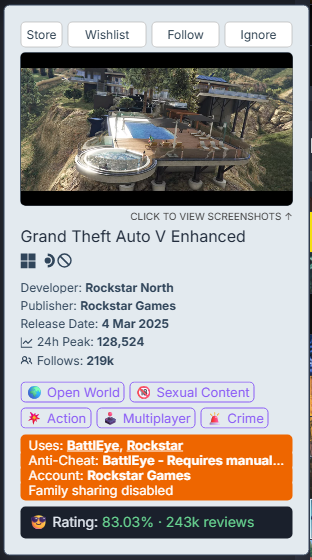
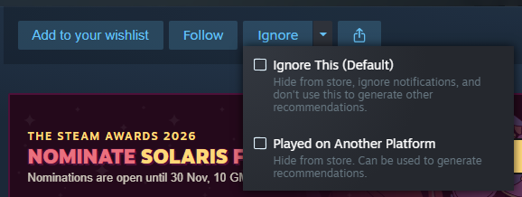
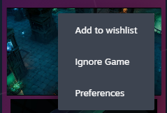

# Popup Hotkeys for SteamDB

A browser extension that adds keyboard shortcuts to the **Store**, **Wishlist**, **Follow** and **Ignore** buttons in the game popup on [steamdb.info](https://steamdb.info/).

Hover over a game, press a key, done. No more moving the mouse into the popup and overshooting it so it disappears.

It also works on the Steam store: on game pages, <kbd>W</kbd>, <kbd>E</kbd>, <kbd>R</kbd> and <kbd>T</kbd> press Steam's own Wishlist, Follow and Ignore buttons, and almost everywhere else on the store (the front page, store lists, recommendations, sale pages such as Specials) you can hover over a game and press <kbd>Q</kbd>, <kbd>W</kbd> or <kbd>R</kbd>. It does nothing on any other site.

[](https://github.com/razingo/hotkeys-steamdb/actions/workflows/tests.yml)

| With the [SteamDB extension](https://github.com/SteamDatabase/BrowserExtension) and a linked Steam account | Without them |
|:---:|:---:|
|  |  |
| <kbd>Q</kbd> <kbd>W</kbd> <kbd>E</kbd> <kbd>R</kbd> all work | Only <kbd>Q</kbd> works |

> [!NOTE]
> This is an independent, unofficial project. It is **not affiliated with, endorsed by or sponsored by Steam, Valve Corporation or SteamDB.**

## Shortcuts

| Key | Action |
|-----|--------|
| <kbd>Q</kbd> | Open the game's Steam store page (in a background tab by default) |
| <kbd>W</kbd> | Add to or remove from your wishlist |
| <kbd>E</kbd> | Follow or unfollow |
| <kbd>R</kbd> | Ignore or unignore |
| <kbd>T</kbd> | Steam store game pages only: ignore as **Played on Another Platform** (the second option in Steam's Ignore menu) |

- On steamdb.info, shortcuts work while a game popup is open.
- On a Steam store game page, <kbd>W</kbd>, <kbd>E</kbd>, <kbd>R</kbd> and <kbd>T</kbd> work whenever Steam shows its Wishlist, Follow and Ignore buttons, which is when you're signed in to Steam. <kbd>Q</kbd> does nothing there, since you're already on the store page.
- In Steam store lists, such as the tabs on the front page or search results, hover over a game and press <kbd>Q</kbd> to open its page, <kbd>W</kbd> to add it to or remove it from your wishlist, or <kbd>R</kbd> to ignore or unignore it.
- On Steam's newer game capsules, such as Discounts & Events or Your Personal Calendar on the front page, hover over a game and press <kbd>Q</kbd> to open its page, or <kbd>W</kbd> or <kbd>R</kbd> to pick "Add to wishlist" / "Remove from wishlist" or "Ignore Game" / "Remove from ignore list" from its ⋯ menu.
- In the recommendation boxes at the bottom of the Steam front page ("Since you wish for …"), hover anywhere over a box and press <kbd>Q</kbd> to open its game, <kbd>W</kbd> to add it to or remove it from your wishlist, or <kbd>R</kbd> to ignore or unignore it. The box's own buttons can only add, so the extension uses Steam's own wishlist and ignore functions instead.
- On Steam's sale pages, such as [Specials](https://store.steampowered.com/specials), hover over a game's tile and press <kbd>Q</kbd> to open it, or <kbd>W</kbd> to press the tile's own "Add to wishlist" / "Remove from wishlist" button. Those tiles have no Ignore, so <kbd>R</kbd> does nothing there.
- Over any other link to a game, <kbd>Q</kbd> opens its store page. On a game page, hovering over a different game makes the keys apply to that game instead of the page's.
- The Steam store shortcuts can be turned off in the settings.
- Shortcuts never fire while you're typing in a search box or other text field.
- All shortcuts can be changed, including combinations such as <kbd>Ctrl</kbd> + <kbd>Shift</kbd> + <kbd>Q</kbd>, or turned off.
- Keys go by their physical position, so they work with any keyboard layout.
- Each shortcut has a 1-second cooldown. Wishlist, Follow and both Ignore shortcuts share it, because each one sends a request to Steam and pressing keys quickly can get you temporarily blocked. A press during the cooldown is ignored and the button flashes amber.

### On the Steam store

| Game pages | Store lists and capsules: hover over a game |
|:---:|:---:|
|  |  |
| <kbd>W</kbd> wishlist, <kbd>E</kbd> follow, <kbd>R</kbd> ignore, <kbd>T</kbd> played on another platform | <kbd>Q</kbd> open its page, <kbd>W</kbd> wishlist, <kbd>R</kbd> ignore |

## Requirements

- Chrome, Edge, Brave, Opera or another Chromium-based browser, or Firefox 140 or newer.
- On the Steam store: being signed in to Steam.
- For Wishlist, Follow and Ignore on steamdb.info:
  - Your Steam account linked to SteamDB (**Sign in** on steamdb.info).
  - The official [SteamDB extension](https://github.com/SteamDatabase/BrowserExtension), and being signed in to the Steam store in the same browser.

  steamdb.info only shows those buttons when SteamDB's extension is installed, and it carries them out; this one only presses the buttons for you. The Store shortcut works without either.

## Install

The extension isn't in the browser stores yet, so it's loaded from source.

### Chrome, Edge, Brave, Opera

1. Download this repository (**Code → Download ZIP**) and unzip it, or clone it.
2. Open `chrome://extensions` (or `edge://extensions`).
3. Turn on **Developer mode**.
4. Click **Load unpacked** and choose the folder that contains `manifest.json`.
5. Reload any open steamdb.info and Steam store tabs.

Keep the folder where it is: the browser loads the extension from it. To update, replace the files, click the reload icon on the extension's card, then refresh open steamdb.info and Steam store tabs. Steam tabs keep running the previous version of `steam-page-click.js` until they're refreshed.

### Firefox

1. Open `about:debugging#/runtime/this-firefox`.
2. Click **Load Temporary Add-on…** and choose `manifest.json`.

Firefox removes temporary add-ons when it restarts.

## What's new

See the [changelog](CHANGELOG.md).

## Settings

Click the extension's toolbar icon, or open its **Options** from the extensions page.

- **Change a shortcut:** click it and press the new key or combination. <kbd>Esc</kbd> cancels.
- **Turn a shortcut off:** press <kbd>Backspace</kbd> while it's waiting for a key, or click **×**.
- **Browser shortcuts:** ones the browser keeps for itself, such as <kbd>Ctrl</kbd> + <kbd>T</kbd> or <kbd>Ctrl</kbd> + <kbd>W</kbd>, can't be used. Common ones such as <kbd>Ctrl</kbd> + <kbd>F</kbd> or <kbd>Space</kbd> can, but you'll see a warning: on SteamDB popups and the Steam store they do this extension's action instead of the browser's.
- **Store page:** choose whether it opens in a background tab or switches to it.
- **Also on the Steam store:** turn the shortcuts on Steam's own pages on or off.
- **Sync settings between your browsers:** on by default, using your browser's sync when that's turned on. Turn it off to keep this browser's shortcuts to itself; the setting is per browser.
- **Reset to defaults** restores Q / W / E / R / T and the options above, except sync.
- The **About** tab and the buttons at the bottom link to this repository and to Buy Me a Coffee.

Settings save immediately and apply to open tabs without reloading.

## Privacy

The extension collects no data and sends no requests of its own. On Steam's pages it only presses Steam's own buttons and menus, or calls the functions Steam's own menus use, so Steam receives exactly the requests it would get if you clicked. Your shortcut settings are stored with your browser's extension storage.

Permissions:

| Permission | Why |
|------------|-----|
| `storage` | Save your shortcut settings |
| Content script on `https://steamdb.info/*` | Listen for the shortcuts on SteamDB pages |
| Content script on `https://store.steampowered.com/*` | Listen for the shortcuts on Steam store pages |

It also opens new tabs, but only for `https://store.steampowered.com/` pages.

## How it works

SteamDB draws the popup itself, so the extension finds it by its visible text (the Store button and "Click to view screenshots", or all four button labels) rather than by the site's internal class names. When a shortcut is pressed while the popup is visible, it clicks the matching button, exactly as a mouse click would. A key whose button isn't in the popup is left alone.

On Steam store game pages, it looks for buttons labelled Wishlist, Follow and Ignore in the box under the game's header, and presses whichever version is shown (e.g. "Follow" or "Following"). <kbd>T</kbd> presses "Played on Another Platform" in Steam's Ignore menu without opening it. In store lists and recommendation boxes, it uses the game under the mouse and calls the same functions Steam's own options menu uses (`GDynamicStore`), so <kbd>W</kbd> and <kbd>R</kbd> add or remove depending on whether the game is already on your wishlist or ignored. The "ON WISHLIST" and "IGNORED" badges are redrawn straight away, like with Steam's own menu, and again once Steam confirms the change. On Steam's newer capsules, it clicks the ⋯ button Steam shows while the mouse is over the capsule, then picks the option from its menu. On sale pages, it presses the "Add to wishlist" / "Remove from wishlist" button Steam shows on the tile under the mouse. Links to games, even with an "ON WISHLIST" badge, never count as buttons. The clicks happen through `steam-page-click.js`, which runs in the Steam page's own context: Steam's Wishlist button is a `javascript:` link, and browsers don't run those when an extension clicks them.

If SteamDB or Steam change that text, or show it in another language, the shortcuts can stop working. Please [open an issue](https://github.com/razingo/hotkeys-steamdb/issues) if that happens.

| File | Purpose |
|------|---------|
| `manifest.json` | Extension manifest (Manifest V3, Chrome and Firefox) |
| `shared.js` | Default shortcuts, settings storage and key matching, used by both scripts below |
| `content.js` | Runs on steamdb.info and the Steam store: finds the buttons and handles the shortcuts |
| `steam-page-click.js` | Runs in the Steam store page's own context and clicks Steam's buttons for `content.js` |
| `background.js` | Opens the store page in a new tab |
| `options.html`, `options.css`, `options.js`, `tabs.js` | Settings page and toolbar popup |
| `icons/` | Extension icons (16, 32, 48 and 128 px) |
| `docs/` | Screenshots for this README (not part of the extension) |
| `store/` | Screenshots, promo tile and [guide to publishing and updating](store/PUBLISHING.md) in the browser stores (not part of the extension) |
| `build.ps1` | Builds the ZIP for the browser stores in `dist/`: `powershell -ExecutionPolicy Bypass -File build.ps1` |
| `tests/`, `playwright.config.js`, `package.json` | Automated tests (not part of the extension) |
| `CHANGELOG.md` | What changed in each version |

## Development

The extension itself has no dependencies or build step. The tests need [Node.js](https://nodejs.org/) 20 or newer.

```powershell
npm install
npx playwright install chromium firefox
npm test
```

The tests run the extension's scripts in Chromium and Firefox on mock SteamDB and Steam store pages, test the settings page, and load the packaged extension into Chromium. GitHub runs them, plus Firefox's add-on validator (`web-ext lint`), on every push.

## Troubleshooting

**"Extension error … is not valid JSON" on SteamDB.** This message comes from the SteamDB extension: Steam answered a Wishlist, Follow or Ignore request with an error page. It usually means Steam is temporarily blocking requests (too many in a short time, a VPN, or Steam maintenance). Wait a few minutes and try again. Clicking the button with the mouse gives the same error.

**A key does nothing.** Make sure you're on steamdb.info with the popup open, or on the Steam store with the mouse over a game (or on a game's page) while signed in to Steam, and that you're not typing in a text field. Not every part of the store offers every action: sale pages have no Ignore, and the Follow and "Played on Another Platform" keys only work on game pages. If only <kbd>Q</kbd> works, check that your Steam account is linked to SteamDB and the SteamDB extension is installed (see Requirements). If it still doesn't work, the site may have changed its buttons; please open an issue.

**Something works with the mouse but not with a key after updating.** Refresh the Steam tab. Steam pages keep the previous version of the extension's page script until they're reloaded.

**Steam's wishlist list looks out of date.** Steam's own wishlist data can lag a few seconds behind a change, for example on your wishlist page. The change itself has been made.

## Support

If the shortcuts save you some clicks, you can [buy me a coffee](https://buymeacoffee.com/razingo) ☕

## License

[MIT](LICENSE)

Steam is a trademark of Valve Corporation. All other names and trademarks belong to their respective owners.
